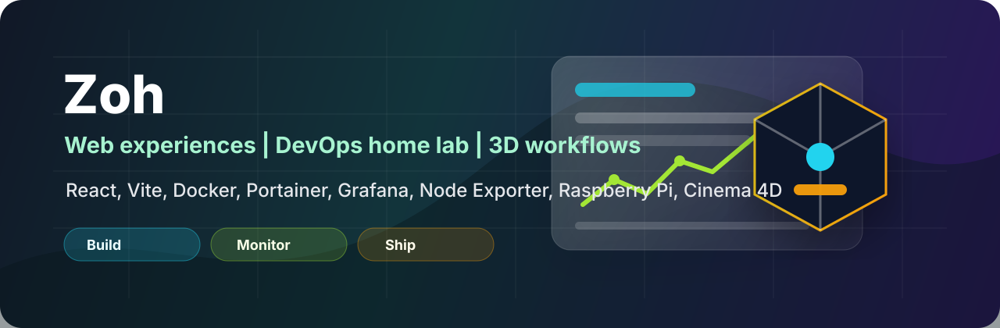
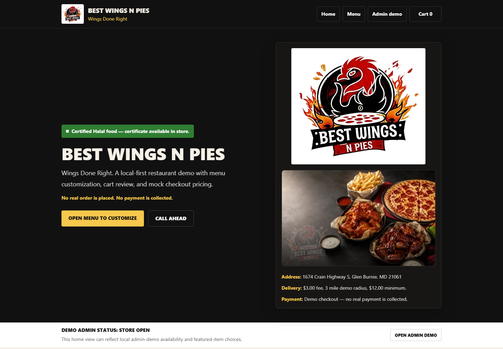
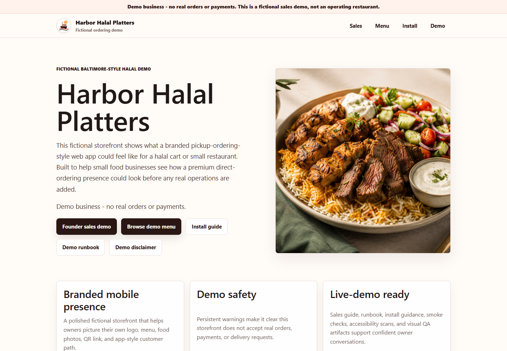
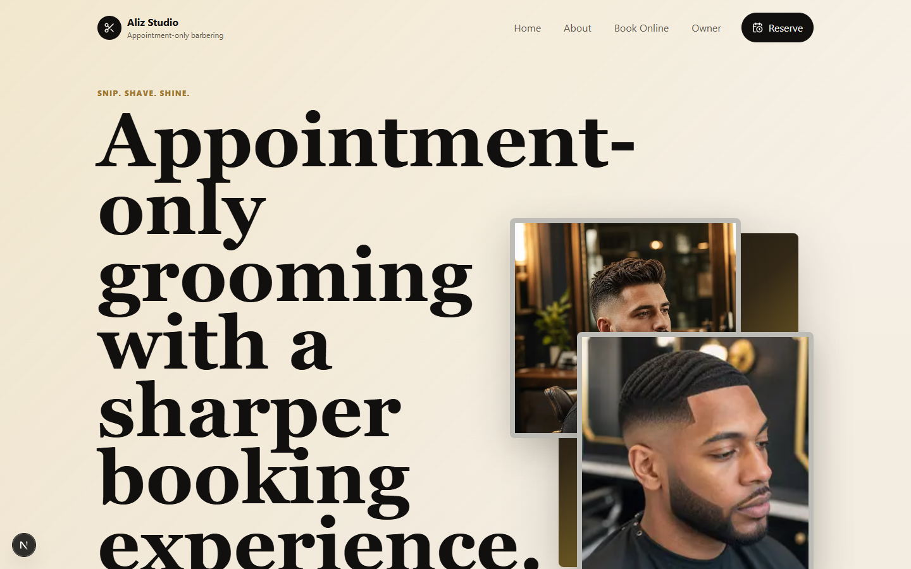
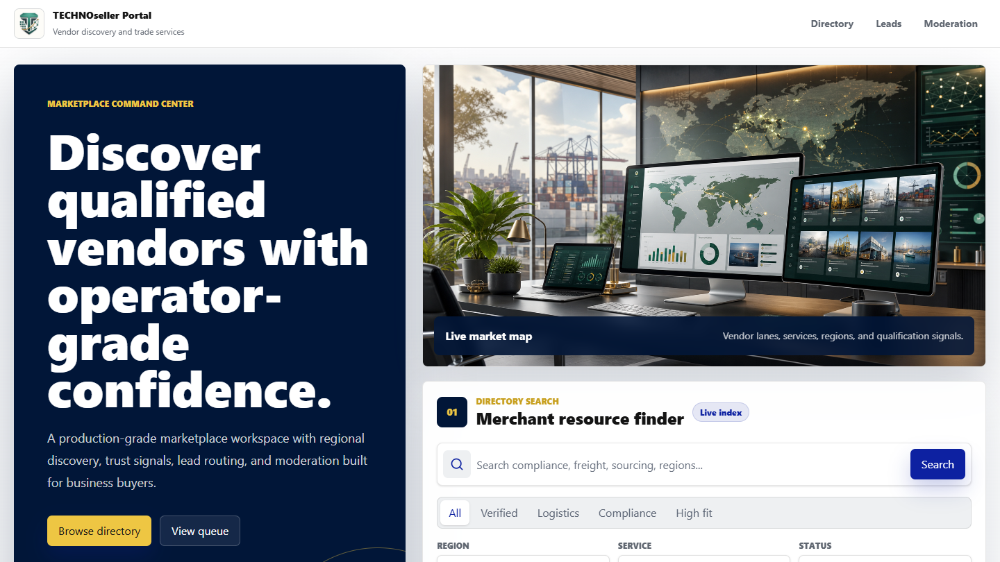
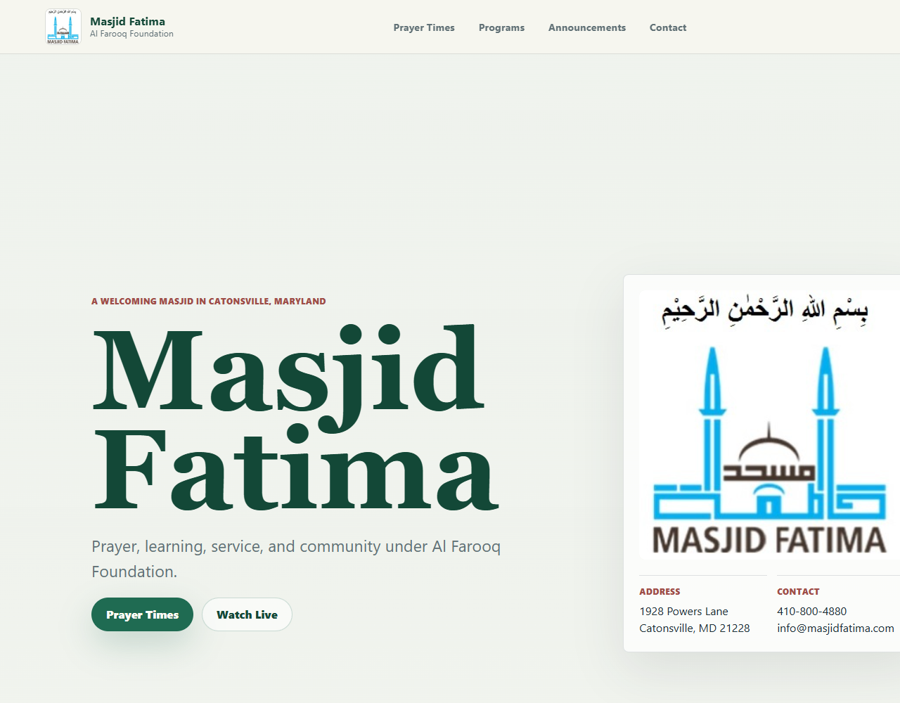
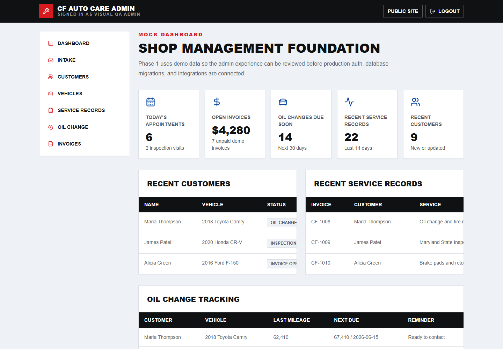
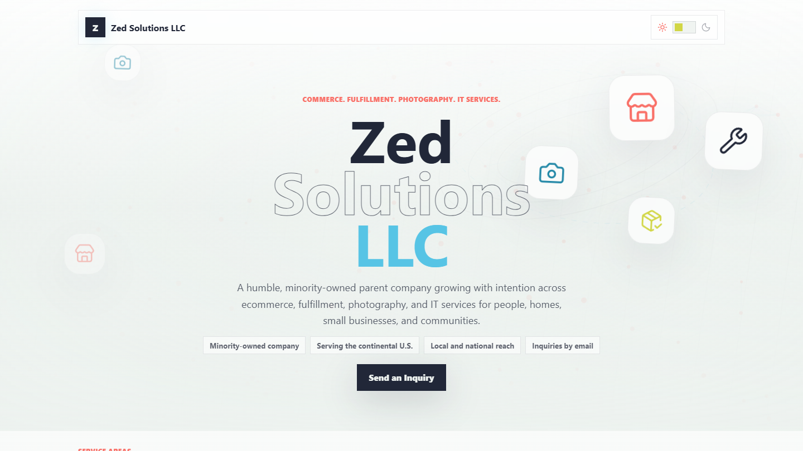
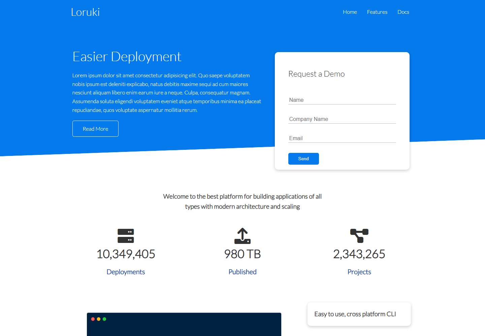
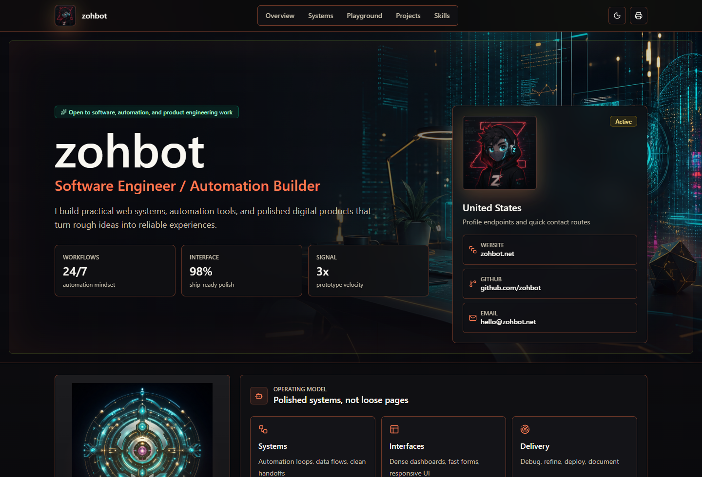

  

  
  
  
  
  

# Hi, I'm Syed

I build websites, small business tools, brand systems, and the kind of home lab infrastructure that teaches you how things really work.

Most of my recent work sits between polished front-end builds and practical operations: React/Vite sites, responsive layouts, Playwright checks, Docker services, monitoring, private networking, and clean project packaging for real clients or future buyers.

For website builds, templates, automation, or customer work, visit [World Softwares](https://worldsoftwares.com).

## What I'm Working On

- Building small business websites and product concepts that can be shown, tested, and handed off cleanly
- Shaping restaurant and local-business demo apps with menu browsing, mock checkout flows, install guidance, and owner-facing sales screens
- Developing a Raspberry Pi 5 homelab with Docker Compose, a custom Home Portal and Control Center, media automation, retro gaming, and private networking
- Improving reliability through DNS diagnostics, incident tracking, encrypted backups, restore drills, guarded updates, and verified Discord notifications
- Turning older design/graphics work into cleaner modern web showcases
- Exploring Cinema 4D, Redshift, PBR materials, and product-style visuals

## Recent Updates

- **Home Pi Infrastructure:** expanded the Pi 5 into a multi-stack homelab with a mobile-friendly service portal, authenticated administration, self-hosted AIOStreams for Stremio, media delivery, RomM, encrypted recovery, and daily health reporting.
- **Best Wings N Pies:** a restaurant ordering MVP demo with menu customization, cart review, mock checkout pricing, admin-demo state, public demo QA, and clear no-real-payment guardrails.
- **Harbor Halal Platters:** a fictional halal platter storefront demo with QR menu launch, platter customization, local favorites/reorder, checkout preview, install guidance, and static owner-preview screens.
- **CF Auto Care Admin Foundation:** a private auto-service operations build with admin dashboard work, intake, customer/vehicle records, service records, oil-change tracking, and invoice surfaces.
- **Masjid Fatima Website Draft:** a mosque website rebuild concept with multilingual visitor paths, prayer-time continuity, donation/media links, and a staff dashboard foundation.
- **Aliz Studio:** an appointment-based barbershop site with a premium homepage, service packaging, booking flow, mock deposit checkout, and owner dashboard work.
- **TECHNOseller Portal:** a vendor marketplace concept with searchable listings, vendor profiles, buyer lead capture, and moderation workflows.
- **Cloud Website and Web Resume:** older front-end foundations refreshed with screenshot-backed presentation and World Softwares inquiry routing.

## Toolkit

  
  
  
  
  
  
  
  
  
  
  
  
  
  
  
  
  
  
  
  
  
  
  
  

## Home Lab / DevOps

Built and operated a Raspberry Pi 5 homelab that has supported 20 containers across infrastructure, media, gaming, and streaming Compose projects, alongside systemd-managed services. Dedicated system, media, backup, and retro-library drives connect through a powered USB hub. The capabilities below describe implemented work, rather than a live uptime report.

<table>
  <tr>
    <td width="50%" valign="top">
      <h3>Pi 5 Service Platform</h3>
      
Built a Debian-based Docker Compose environment for everyday home services, moving the media workflow off the main PC. Portainer and container health checks provide service visibility.

      
<strong>Relevant work:</strong> Linux, Docker Compose, systemd, application migration, storage mounts, service validation.

    </td>
    <td width="50%" valign="top">
      <h3>Home Portal and Control Center</h3>
      
Created a mobile-friendly service index with live health badges, storage statistics, interactive previews, incident history, and an installable offline shell. An authenticated Control Center handles approved maintenance and recovery actions.

      
<strong>Relevant work:</strong> JavaScript, Python, responsive UI, PWA caching, Caddy, authentication, Playwright QA.

    </td>
  </tr>
  <tr>
    <td width="50%" valign="top">
      <h3>Monitoring and Incident Reporting</h3>
      
Combined Netdata, Node Exporter, and custom telemetry for container health, disk capacity, USB resets, filesystem errors, cooling, and DNS failures. Daily Discord reports, grouped incident alerts, recovery notices, and a change journal make the system easier to follow.

      
<strong>Relevant work:</strong> observability, incident lifecycle tracking, alert deduplication, log classification, notification delivery checks.

    </td>
    <td width="50%" valign="top">
      <h3>DNS Reliability and Private Access</h3>
      
Built encrypted DNS forwarding with <code>ctrld</code>, NextDNS, and fallback resolvers, plus CoreDNS for local service aliases. Active probes help distinguish resolver failures from local network problems; Tailscale provides private remote access.

      
<strong>Relevant work:</strong> encrypted DNS, failover diagnostics, split DNS, Caddy routing, Tailscale, firewall policy.

    </td>
  </tr>
  <tr>
    <td width="50%" valign="top">
      <h3>Media Delivery and Library Automation</h3>
      
Integrated Plex, Seerr, Sonarr, Radarr, Prowlarr, Bazarr, qBittorrent, and SABnzbd. Built a phone-friendly TorBox queue with flexible search, batch selection, duplicate checks, transfer progress, retries, and Plex delivery verification. Watched-media cleanup includes a grace period and a preview of pending items.

      
<strong>Relevant work:</strong> API integration, durable background jobs, media imports, VPN-isolated downloads, safe retention workflows.

    </td>
    <td width="50%" valign="top">
      <h3>Retro Library and Game Streaming</h3>
      
Deployed RomM for a catalogued ROM collection, browser-based play, and controller-enabled clients. Added duplicate review and monitored CHD compression workflows, alongside a separate Moonlight streaming path for remote play.

      
<strong>Relevant work:</strong> RomM, library organization, storage optimization, controller troubleshooting, remote gaming.

    </td>
  </tr>
  <tr>
    <td width="50%" valign="top">
      <h3>Encrypted Backup and Recovery</h3>
      
Implemented Restic backups of configuration and application state to a separate drive, scheduled repository checks, sample restores, and isolated restore drills. A recovery runbook, portable pack without credentials, and move-readiness workflow support rebuilding and relocating the lab. Bulk media is separate from this backup scope.

      
<strong>Relevant work:</strong> encrypted snapshots, retention, integrity verification, recovery documentation, restore testing.

    </td>
    <td width="50%" valign="top">
      <h3>Guarded Maintenance and Administration</h3>
      
Added package, container, and OpenClaw update controls with activity and storage checks, backup gates, and post-update health verification. Failed container-stack checks can restore saved images; post-boot checks verify essential services. Privileged web actions use a narrow helper allowlist.

      
<strong>Relevant work:</strong> least-privilege administration, controlled updates, container rollback, post-boot recovery, audit trails.

    </td>
  </tr>
</table>

Self-hosted AIOStreams on the Pi using Docker Compose and a Cloudflare Tunnel for remote HTTPS access from Stremio. Integrated add-on aggregation, catalogues, provider accounts, and stream filtering, with monitoring that distinguishes application and tunnel failures from upstream provider errors. OpenClaw is part of the lab's agent tooling; maintenance permissions remain explicitly controlled.

## Website Builds and Product Concepts

<table>
  <tr>
    <td width="50%" valign="top">
      
      <h3>Best Wings N Pies</h3>
      
A local-first restaurant ordering MVP demo with menu customization, cart review, mock checkout pricing, admin-demo state, and public-demo QA.

      
<strong>Stack:</strong> Next.js App Router, TypeScript, Tailwind CSS, local demo cart state, Node tests, Playwright QA.

      
<strong>Credit:</strong> Website demo, ordering UX, and public presentation by <a href="https://worldsoftwares.com">SYHTEK</a>.

    </td>
    <td width="50%" valign="top">
      
      <h3>Harbor Halal Platters</h3>
      
A fictional halal platter storefront demo for owner conversations, with QR menu launch, platter customization, local favorites, checkout preview, and install guidance.

      
<strong>Stack:</strong> Next.js App Router, TypeScript, Tailwind CSS, qrcode, Vitest, Playwright, axe accessibility checks.

      
<strong>Credit:</strong> Demo storefront, brand system, and sales-demo flow by <a href="https://worldsoftwares.com">SYHTEK</a>.

    </td>
  </tr>
  <tr>
    <td width="50%" valign="top">
      
      <h3>Aliz Studio</h3>
      
An appointment-only barbershop website with a premium homepage, clear service packaging, guided booking, mock deposit checkout, and owner dashboard work.

      
<strong>Stack:</strong> Next.js App Router, React, TypeScript, custom CSS tokens, Square-ready API routes, signed owner sessions, Playwright checks.

      
<strong>Credit:</strong> Website design, booking UX, and implementation by <a href="https://worldsoftwares.com">SYHTEK</a>.

    </td>
    <td width="50%" valign="top">
      
      <h3>TECHNOseller Portal</h3>
      
A vendor marketplace concept with searchable listings, service data, vendor profiles, buyer lead capture, and moderation tools.

      
<strong>Stack:</strong> React, Vite, Tailwind CSS, Radix primitives, Node HTTP API, structured marketplace data.

      
<strong>Credit:</strong> Product direction and implementation by <a href="https://worldsoftwares.com">SYHTEK</a>.

    </td>
  </tr>
  <tr>
    <td width="50%" valign="top">
      
      <h3>Masjid Fatima Website Draft</h3>
      
A mosque website and early community web-app concept with prayer-time continuity, multilingual visitor paths, donation/media links, and a staff dashboard foundation.

      
<strong>Stack:</strong> Plain JavaScript modules, custom CSS, Vite, Node HTTP API, PWA basics, Playwright, local security review.

      
<strong>Credit:</strong> Website draft, logo exploration, app foundation, and security review by <a href="https://worldsoftwares.com">SYHTEK</a>.

    </td>
    <td width="50%" valign="top">
      
      <h3>CF Auto Care Admin Foundation</h3>
      
A private shop-operations foundation with dashboard cards, appointment intake, customer and vehicle records, service records, oil-change tracking, and invoice screens.

      
<strong>Stack:</strong> Next.js App Router, TypeScript, Prisma, PostgreSQL/Supabase-ready schema, server actions, Playwright visual QA.

      
<strong>Credit:</strong> Admin UX, data model direction, and staging documentation by <a href="https://worldsoftwares.com">SYHTEK</a>.

    </td>
  </tr>
  <tr>
    <td width="50%" valign="top">
      
      <h3>Zed Solutions LLC</h3>
      
A business splash page and brand workspace for a parent company covering ecommerce, fulfillment support, photography, IT services, and practical business infrastructure.

      
<strong>Stack:</strong> React, Vite, custom CSS animation, Cloudflare Pages direction, responsive visual QA.

      
<strong>Credit:</strong> Website design and implementation by <a href="https://worldsoftwares.com">SYHTEK</a>.

    </td>
    <td width="50%" valign="top">
      
      <h3>Cloud Website</h3>
      
A static cloud-hosting website template with homepage, feature, documentation, contact, and responsive layout surfaces.

      
<strong>Stack:</strong> HTML, CSS, responsive layout utilities, static hosting direction, simple form markup.

      
<strong>Credit:</strong> Template cleanup and presentation by <a href="https://worldsoftwares.com">SYHTEK</a>.

    </td>
  </tr>
  <tr>
    <td colspan="2" valign="top">
      
      <h3>Zohbot Web Resume</h3>
      
A modern web resume for zohbot.net with a React interface, print-friendly resume view, project sections, and contact routes.

      
<strong>Stack:</strong> React, Vite, Tailwind CSS, Radix-style components, GitHub Pages publishing direction.

      
<strong>Credit:</strong> Visual system and implementation by <a href="https://worldsoftwares.com">SYHTEK</a>.

    </td>
  </tr>
</table>

## Other Technical Work

<table>
  <tr>
    <td width="50%" valign="top">
      <h3>Proweaver Website Technology Audit</h3>
      
A hands-on review of a live WordPress marketing site, covering front-end libraries, animations, tracking scripts, accessibility tools, forms, hosting signals, and visible UX behavior.

      
<strong>Relevant work:</strong> WordPress, jQuery, animation libraries, tracking pixels, Cloudflare behavior, UI/UX review, technical documentation.

    </td>
    <td width="50%" valign="top">
      <h3>Cinema 4D / Redshift Material Workflows</h3>
      
A starter material library and scene workflow using CC0 PBR texture sets for Redshift and Cinema 4D experiments.

      
<strong>Relevant work:</strong> PBR map wiring, material setup, scene composition, chrome/neon styling, dynamic text, render-ready asset organization.

    </td>
  </tr>
</table>

## Showcase Project Links

Selected website and product concept work. Project links route through World Softwares for inquiries.

| Project | What It Shows | Tech |
| --- | --- | --- |
| [Best Wings N Pies](https://worldsoftwares.com) | Restaurant ordering MVP demo with menu customization and mock checkout | Next.js, TypeScript, Tailwind CSS, Playwright |
| [Harbor Halal Platters](https://worldsoftwares.com) | Fictional halal platter storefront and sales-demo flow | Next.js, TypeScript, Tailwind CSS, Vitest, Playwright |
| [CF Auto Care Admin Foundation](https://worldsoftwares.com) | Private shop-operations dashboard and admin workflow foundation | Next.js, Prisma, TypeScript, Playwright |
| [Cloud-Website](https://worldsoftwares.com) | Static cloud-hosting website template | HTML, CSS, responsive static pages |
| [Zed Solutions LLC](https://worldsoftwares.com) | Parent-company brand and business splash page | React, Vite, custom CSS |
| [technoseller](https://worldsoftwares.com) | Vendor marketplace and lead-routing concept | React, Vite, TypeScript, Tailwind CSS, Node API |
| [webresume](https://worldsoftwares.com) | Modern portfolio/resume website | React, Vite, Tailwind CSS, Radix-style components |
| [Aliz-Studio](https://worldsoftwares.com) | Appointment-based barbershop website, mock checkout, and owner dashboard | Next.js, React, TypeScript, Square-ready API routes, Playwright |
| [masjid-fatima-draft](https://worldsoftwares.com) | Mosque website and early community web-app rebuild | Plain JavaScript, Vite, Node API, PWA, Playwright, security review |

## Skills

**Front-end:** React, Vite, HTML, CSS, responsive design, static sites, landing pages

**DevOps and home lab:** Raspberry Pi 5, Debian, Docker Compose, Portainer, systemd, Python automation, Netdata, Node Exporter, Caddy, CoreDNS, Tailscale, `ctrld`, NextDNS, encrypted DNS, Restic, recovery drills, guarded updates, incident reporting; earlier work with Grafana, Prometheus-style metrics, and Oracle VM

**Testing and QA:** Playwright, visual checks, screenshot review, browser-based inspection

**Web audits:** WordPress stack review, JavaScript/CSS library identification, analytics and tracking review, UX notes

**Deployment:** Cloudflare Pages, GitHub Pages, static hosting workflows

**Design systems:** Brand briefs, identity systems, logo direction, shared assets, email signature concepts

**3D and visuals:** Cinema 4D, Redshift, PBR materials, texture workflows, product-style rendering

## What I Like Building

I like taking rough ideas and turning them into something people can actually use: a site that looks good on desktop and mobile, a brand system that can ship, or a local service that is staged, monitored, privately accessible, and easier to maintain.

## Links

- GitHub: [zohbot](https://github.com/zohbot)
- Website inquiries: [World Softwares](https://worldsoftwares.com)
- Project inquiries: [Best Wings N Pies](https://worldsoftwares.com), [Harbor Halal Platters](https://worldsoftwares.com), [CF Auto Care](https://worldsoftwares.com), [Cloud-Website](https://worldsoftwares.com), [Zed Solutions LLC](https://worldsoftwares.com), [technoseller](https://worldsoftwares.com), [webresume](https://worldsoftwares.com), [Aliz-Studio](https://worldsoftwares.com), [masjid-fatima-draft](https://worldsoftwares.com)
